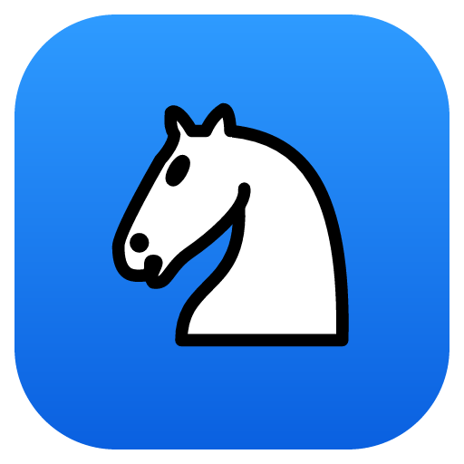

<p align="center">
  
</p>

<h1 align="center">ChessCoach</h1>

<p align="center">
  <strong>A chess coach that sits next to your board and teaches you while you play.</strong><br>
  Works with any website or app that shows a chessboard. Runs entirely on your own Windows PC.
</p>

<p align="center">
  <a href="docs/setup.md">Setup guide</a> &middot;
  <a href="docs/architecture.md">How it works</a> &middot;
  <a href="CONTRIBUTING.md">Contributing</a>
</p>

---

## What is ChessCoach?

Think of learning English. You can read a grammar book, or you can have a tutor sit beside you while
you actually talk, who gently corrects you, explains *why*, and asks you to try again. That is
the difference between knowing rules and getting good.

ChessCoach is that tutor for chess. You play your games wherever you like (chess.com, lichess, a
study board, a bot, any website or program that shows a board), and ChessCoach watches the board on
your screen like a patient teacher looking over your shoulder. It then:

* **explains** what is happening in plain words ("this pins your knight to the queen"),
* **grades every move you make** (best, good, playable, mistake, blunder) and tells you what was better,
* **teaches openings** such as the London System, English Opening or Caro-Kann, so you learn a repertoire
  by playing it, instead of memorising lines,
* **points at the idea on your real board** with an arrow, and can say it out loud.

You stay in charge of the game. You still think and you still make every move yourself.

## A coach, not a cheating tool

ChessCoach is built for **learning**, and several of its features exist only because of that:

* **You choose how much help you get.** In *Guided* mode it shows the idea and the arrow. In *Practice*
  mode it stays quiet until you press **Hint**, so you try first. In *Test* mode it gives no help at all
  until you ask, and your accuracy is saved on the **Progress** page so you can watch yourself improve.
* **It teaches the plan, not just the strongest move.** The opening trainer follows the system you chose
  even where the engine would play differently, because the goal is that *you* learn the system.
* **It is about understanding.** Every suggestion comes with a reason, and every move you play gets a
  grade and an explanation, so you can improve without the coach.
* **It never plays for you.** ChessCoach does not click, drag or type in any website or program. It only
  looks at the screen and talks to you. It uses no website accounts, no website data feeds and no
  automation of any site.

Like a human coach, it is something you use for **practice, analysis and study**, where help is
welcome. A coach in the room during a tournament would not be allowed, and neither is this.

> **Fair play:** use live coaching only where outside assistance is explicitly allowed, such as offline
> practice, games against bots, a study board, or reviewing your own games. Do not use it during online
> matches or tournaments that prohibit engine help. Respecting a site's rules is your responsibility.

## Why it works on any website

Chess websites do not offer a way for other programs to follow your live game. So ChessCoach does not
ask the website anything. It simply **reads the picture of the board on your screen**: it finds the
board, works out which squares hold which pieces, and uses the rules of chess to work out which move was
played. Because it only looks at pixels, it works the same on any site, any board colours and any piece
style. [How it works, in detail](docs/architecture.md#6-reading-a-chess-board-from-the-screen).

## What is included, and what is not

| | In this version? |
| --- | --- |
| The ChessCoach app, the coaching and opening trainer, the opening book, the screen reader | Yes |
| **Following a game from its start**: you play, ChessCoach follows every move (also when the opponent answers instantly, several moves are missed, or you take a move back) | Yes |
| The Stockfish chess engine | Not in the source repository (download it, see the [setup guide](docs/setup.md)); the Windows installer has it built in |
| **The piece-recognition model** (a small trained neural network) | **No, it is not provided** |
| Joining a game that is **already under way** | **Not available in this version** (needs the model above) |
| Any cloud service, account, chatbot or online AI | None. Everything runs on your PC |

### Joining a game in progress does not work (yet)

To follow a game that has already started, ChessCoach would have to recognise which piece stands on
which square without ever having seen the starting position. That needs a trained piece-recognition
model, and **this model has not been added to this version**. So:

* **Start the session on a new game**, and select the board while it still shows the starting position.
  Then everything works: reading both players' moves, grading, advice, openings.
* If you select a board that is already mid-game, ChessCoach tells you that joining a game in progress is
  not available in this version, and asks you to start a new game instead.
* The same missing model means that, if the app ever loses track of a game completely and cannot follow
  it move by move, it cannot rebuild the position from the screen by itself. Press **Re-read**, type the
  move, or start a new game.

Nothing else depends on the model. There is no AI chatbot in ChessCoach: the advice comes from the
Stockfish engine plus the app's own explanations of chess ideas.

## Documentation

| Read this | If you want to |
| --- | --- |
| **[Setup guide](docs/setup.md)** | Install the tools, run ChessCoach, play your first game from the screen, build the installer, and fix common problems. Written step by step for beginners. |
| **[Architecture](docs/architecture.md)** | Understand how it works inside: how it reads a chess board from the screen without any website API, how the Python backend and Electron app talk, how the coach grades moves, how it is tested and packaged. Explained from zero, with diagrams. |
| [Contributing](CONTRIBUTING.md) | Test and change the code. |
| [Third-party notices](THIRD_PARTY_NOTICES.md) | Licences of the pieces, engine and libraries used. |
| [Model notes](models/README.md) | The optional piece recogniser used when joining a game in progress. |

## Run from source

The short version is below; the [setup guide](docs/setup.md) explains every step and what to do when
something goes wrong.

You need Windows 10 or 11, [Python 3.12](https://www.python.org/downloads/),
[Node.js 22.12 or later](https://nodejs.org/), and [Stockfish](https://stockfishchess.org/download/).

From the repository root in PowerShell:

```powershell
py -3.12 -m venv .venv
.\.venv\Scripts\python.exe -m pip install -r requirements.txt
npm --prefix app ci
```

Extract the Stockfish download under `bin/`, put `stockfish.exe` on `PATH`, or set `STOCKFISH_PATH`
to the executable's full path. Then double-click `ChessCoach.bat` or run `npm --prefix app start`.

## Use ChessCoach

- **On this board:** Enter moves for either side and get explanations, evaluations, and move grades.
- **From my screen:** Start a **new game** on your chess website, choose **Select my board**, confirm
  the detected board, and let ChessCoach follow the moves. The board must show the starting position
  when you confirm it: [joining a game that is already in progress is not available in this
  version](#joining-a-game-in-progress-does-not-work-yet). To coach from a custom position instead,
  supply a FEN in Settings.
- **Openings:** Pick an opening plan and choose Guided, Practice, or Test mode to control when
  advice is revealed. Review saved game statistics in **Progress**.

Chess analysis and screen capture run on your computer. The board picker captures the selected
monitor to locate the board. The app saves settings, game history, and diagnostic logs in its local
Electron profile; failed reads can also save a cropped board image there. Review those files before
sharing them with a bug report. The CLI saves its calibration under `data/` by default.

## Command line

The CLI still supports typed moves, a physical board, and a board on screen:

```powershell
.\.venv\Scripts\python.exe main.py --color white
.\.venv\Scripts\python.exe main.py --color white --camera
.\.venv\Scripts\python.exe main.py --screen
```

## Development

```powershell
.\.venv\Scripts\python.exe -m pip install -r requirements-dev.txt
.\.venv\Scripts\python.exe -m pytest
```

See [Contributing](CONTRIBUTING.md) for optional hardware tests and vision tools,
[Architecture](docs/architecture.md) for a detailed beginner-friendly explanation and code map,
[Third-party notices](THIRD_PARTY_NOTICES.md) for asset and dependency attribution, and
[Model notes](models/README.md) for the optional recognizer.

## Building a release (Windows)

One command builds everything a user needs into a single installer and a single portable file, with
nothing else to install (no Python, no Node, no Stockfish):

```powershell
python tools/build_release.py          # backend + installer + portable .exe, then a self-test of the result
python tools/build_release.py --dir    # just the unpacked app folder (quick check of a build)
```

You need the development setup (`.venv` with `pip install -r requirements-build.txt`), Node 22.12+ and
`bin/stockfish*.exe` (or set `CHESSCOACH_STOCKFISH`). For a build you share, add `--no-model`, so the
piece-recognition model is left out even if you have the file locally:

```powershell
python tools/build_release.py --no-model
```

Output, in `release/`:

| File | What it is |
| --- | --- |
| `ChessCoach-Setup-1.0.0.exe` | Installer (per-user, Start menu + desktop shortcut, uninstaller). Fastest to start. |
| `ChessCoach-1.0.0-portable.exe` | One self-contained file, no install. Unpacks itself on every start (about 15-20 s). |
| `win-unpacked/` | The app folder both are made from. |

Step by step, with options and troubleshooting: [setup guide, section 8](docs/setup.md#8-build-the-installer-and-the-single-file-exe).
How it is put together (diagram in [Architecture](docs/architecture.md#12-packaging-how-one-exe-is-made)): `packaging/backend.spec` freezes the Python coach with PyInstaller (the opening
book and Stockfish go inside it, and the piece model only if you have one and did not pass `--no-model`); electron-builder wraps that and the desktop app
(`app/package.json`, key `build`). The app finds its parts by itself: `app.isPackaged` selects the frozen
backend instead of `.venv`.

Check any build, including one you downloaded: `ChessCoach.exe --self-test` prints a JSON report
(engine, opening book, vision, screen capture, voice; and whether the optional piece model is present) and exits
with code 1 if a required part is missing.

Not included yet: code signing (Windows SmartScreen will warn on first run until the files are signed with a
certificate) and automatic updates.

