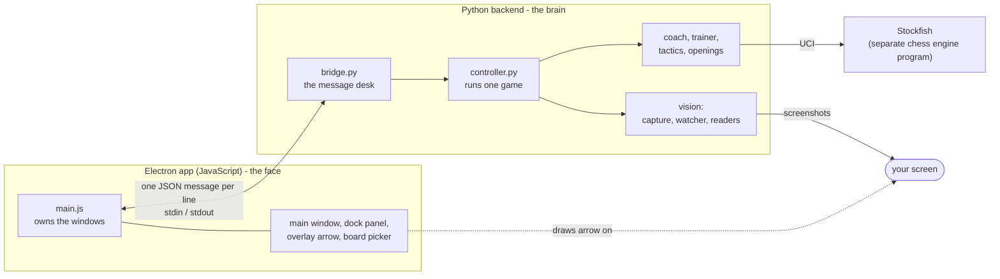
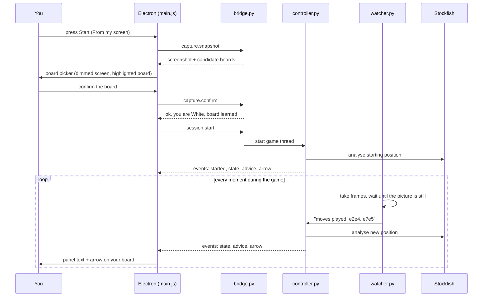
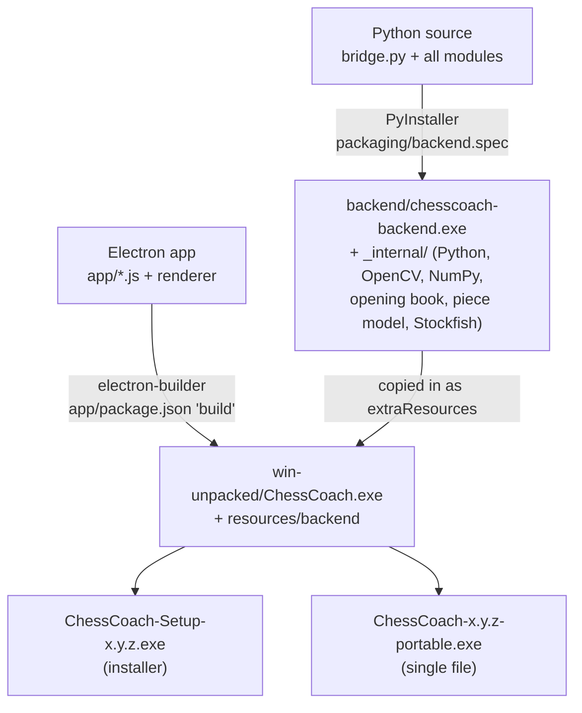

# ChessCoach architecture, explained from zero

This document explains how ChessCoach works inside. You do not need to know chess programming,
computer vision or Electron to follow it. Every new word is explained the first time it appears, and
there is a [glossary](#2-glossary) near the top.

If you only want to install and run the app, read the [setup guide](setup.md) instead.

**Contents**

1. [The idea in one minute](#1-the-idea-in-one-minute)
2. [Glossary](#2-glossary)
3. [The big picture: three parts](#3-the-big-picture-three-parts)
4. [How the parts talk: the bridge protocol](#4-how-the-parts-talk-the-bridge-protocol)
5. [A game session, step by step](#5-a-game-session-step-by-step)
6. [Reading a chess board from the screen](#6-reading-a-chess-board-from-the-screen)
7. [Joining a game that is already under way](#7-joining-a-game-that-is-already-under-way)
8. [When the picture does not match the game](#8-when-the-picture-does-not-match-the-game)
9. [The coaching brain](#9-the-coaching-brain)
10. [The desktop app (Electron)](#10-the-desktop-app-electron)
11. [Where data lives](#11-where-data-lives)
12. [Packaging: how one `.exe` is made](#12-packaging-how-one-exe-is-made)
13. [How it is tested](#13-how-it-is-tested)
14. [Design decisions and limits](#14-design-decisions-and-limits)
15. [Code map: which file does what](#15-code-map-which-file-does-what)
16. [Where do I change...?](#16-where-do-i-change)

---

## 1. The idea in one minute

ChessCoach is a chess teacher that sits next to the board you are already playing on.

There is **no connection to chess.com or lichess**. Websites do not offer a way to ask "what is
happening in my game right now?" while you play (certainly not against their built-in bots). So
ChessCoach does what a human friend looking over your shoulder would do: **it looks at the screen**.

```text
 your screen                 what ChessCoach does with it
 ┌─────────────┐
 │  ♜ ♞ ♝ ♛ ♚ ..│   1. take a screenshot of the board area
 │  ♟ ♟ ♟ ♟ ..  │   2. work out which of the 64 squares hold which pieces
 │  .  .  .  .   │   3. compare with the position it already knows: which move was played?
 │  ♙ ♙ ♙ ♙ ..  │   4. ask the Stockfish chess engine what the best move is
 │  ♖ ♘ ♗ ♕ ♔ ..│   5. explain it in words and draw an arrow on your real board
 └─────────────┘
```

Two facts make this work:

* **Chess has strict rules.** If the app knows the position before a move, only a few dozen moves are
  possible. It does not need to "recognise" a move from nothing; it only needs to find which of the
  few dozen legal moves makes the new picture look the way it does. That is far more reliable than
  reading pixels alone.
* **A board is a regular grid.** Finding 64 squares in a picture is a well-understood image problem.

The program is split into a **Python "brain"** (vision, chess rules, coaching) and an **Electron
"face"** (windows, buttons, arrows). They run as two programs and exchange text messages.

## 2. Glossary

| Word | Meaning |
| --- | --- |
| **FEN** | A one-line text description of a chess position, for example `rnbqkbnr/pppppppp/8/8/8/8/PPPPPPPP/RNBQKBNR w KQkq - 0 1` is the starting position. The app uses FENs to pass positions around. |
| **Ply** | One move by one player. A "move" in chess books is two plies (White's and Black's). |
| **SAN / UCI** | Two ways to write a move. SAN is the human style (`Nf3`, `O-O`). UCI is the computer style (`g1f3`: from square, to square). |
| **Stockfish** | A very strong free chess engine. It is a separate program (`stockfish.exe`). The app talks to it with the **UCI protocol** and asks "how good is this position, and what are the best moves?". |
| **Centipawn (cp)** | The engine's unit of advantage. 100 cp is roughly "one pawn better". The coach grades your moves by how many centipawns they lose compared with the best move. |
| **python-chess** | A Python library that knows all chess rules: legal moves, check, castling, FEN, and so on. The app never re-implements the rules. |
| **Electron** | A way to build desktop apps from web technology (HTML, CSS, JavaScript). It is Chrome plus Node.js in one package. |
| **Main process / renderer** | In Electron, the *main process* controls windows and the operating system. Each window's page runs in a *renderer* process, like a browser tab. |
| **Preload script** | A small, trusted script that gives a window's page a short list of safe functions (such as "call the backend"). The page cannot do anything else with the computer. |
| **IPC** | "Inter-process communication": programs sending messages to each other. |
| **stdin / stdout** | The text input and output of a program. The Electron app starts the Python backend and talks to it by writing lines to its stdin and reading lines from its stdout. |
| **Overlay** | A transparent window drawn on top of everything. The arrow on your board is an overlay. |
| **Warp** | Stretching a cut-out region of a picture so that it becomes a perfect square. |
| **Probability / log-likelihood** | A way to say "how well does this explanation fit what I see?" and compare explanations by a number, instead of by yes/no. |
| **Neural network** | A function with many adjustable numbers ("weights") that is trained on examples. Here a small one recognises chess pieces. |
| **PyInstaller / electron-builder** | Tools that pack the Python program and the Electron app into normal Windows programs. See [packaging](#12-packaging-how-one-exe-is-made). |

## 3. The big picture: three parts



| Part | Written in | Job |
| --- | --- | --- |
| **Electron app** (`app/`) | JavaScript, HTML, CSS | Everything you see and click: the windows, the board, the settings, the arrow, the board picker. It contains no chess knowledge. |
| **Python backend** (root `*.py`) | Python 3.12 | Everything that thinks: capturing the screen, reading the board, applying chess rules, calling the engine, writing the advice. It has no windows. |
| **Stockfish** (`bin/`) | C++ (not ours) | Evaluates positions. Started by the backend as a child program. |

**Why two languages?** Python has excellent libraries for images (OpenCV, NumPy) and chess
(python-chess). Electron makes it easy to draw transparent, click-through windows and a modern
interface. Splitting them lets each part use the best tool, and the two only share a very small,
well-defined message format (next section).

### Four threads inside the Python backend

The backend is not one big loop. It has four cooperating threads (a thread is one flow of work
that runs alongside others):

1. **The reader** (the main thread in `bridge.py`) does nothing but read lines from stdin and put
   them in a queue. It never blocks on slow work.
2. **The request worker** (`bridge.py`) takes requests from that queue **one at a time, in order**,
   so a move can never overtake the hint typed before it.
3. **The game thread** (`controller.py`) runs a session: watching the board, applying moves,
   asking the coach for advice. It checks for new commands between each look at the screen.
4. **The pump** (`bridge.py`) takes events produced by the game thread and writes them to stdout
   for the Electron app.

Keeping the game on its own thread means a slow engine analysis never freezes the message desk, and
the message desk never delays reading the screen.

## 4. How the parts talk: the bridge protocol

Electron starts the backend with `app/python.js`. From then on they exchange **one JSON object per
line**. stdout carries *only* this protocol; anything the Python code prints for debugging is
redirected to stderr so it cannot corrupt the messages.

**A request** (app to backend) has an `id`, a command name and arguments. The backend answers with
the same `id`:

```json
{"id": 7, "cmd": "session.command", "args": {"kind": "hint"}}
{"id": 7, "ok": true, "data": {}}
```

**An event** (backend to app) has no `id`; the backend sends it whenever something happens:

```json
{"event": "advice", "data": {"text": "Consider Bb7. It develops your bishop.", "best": "c8b7", "grade": "good"}}
```

### Commands the app can send

| Command | What it does |
| --- | --- |
| `hello` | First call. Returns settings, the list of opening systems, and game history. |
| `settings.save`, `history.get`, `history.clear` | Store and read settings and game history. |
| `capture.snapshot` | Take a screenshot of a monitor and look for boards in it. |
| `capture.confirm` | The user accepted a rectangle. Check it, and learn what this board looks like. |
| `capture.inspect` | Read a game that is already under way (pieces, side, whose move). |
| `fen.build` | Turn a list of pieces on squares into a legal FEN (or say what is wrong). |
| `capture.cancel` | Drop the screenshot. |
| `session.start`, `session.stop` | Begin or end a game. |
| `session.command` | Something during a game. `kind` is one of `move_uci`, `move_text`, `hint`, `repeat`, `new`, `undo`, `resign`, `voice`, `arrows`, `time`, `level`, `strictness`, `flip_turn`, `reread`. |
| `app.selftest` | Check that the engine, model, opening book, vision, capture and voice all work. |

### Events the backend sends

| Event | Meaning |
| --- | --- |
| `ready` | The backend has started. |
| `started` | A session began (which side you play, whether you joined mid-game). |
| `state` | The current position, move list and engine evaluation. |
| `advice` | The coach's text, the suggested move, the engine's best lines and the grade of your last move. |
| `arrow` | Which move to draw on the board (or none). |
| `notice` | A short message for the user ("You took back 2 moves."). |
| `watch` | What the screen reader is doing: `watching`, `settling`, `unclear` or `lost`. |
| `region` | The board moved on the screen; here is its new place. |
| `restore` | Show the main window again. |
| `error`, `stopped` | Something failed, or the session ended. |

This is the *only* coupling between the two halves. Anyone could replace the Electron app with
another front end that speaks the same lines.

## 5. A game session, step by step

This is the story of "From my screen" mode from the first click to the first arrow. The numbers
in brackets show where in the code it happens.



1. **You press Start.** The page calls `window.coach.startSession(options)` (see `preload.js`),
   which reaches `startSession()` in `app/main.js`.
2. **The screenshot.** `main.js` hides its own window, waits for the screen to repaint, then asks
   the backend for `capture.snapshot`. The backend (`bridge.py`, `screen_capture.py`) grabs the
   monitor and runs `board_detect.py` to find chessboard-shaped rectangles.
3. **The board picker.** A full-screen window (`picker.html`, `picker.js`) shows that screenshot
   dimmed, with the best candidate highlighted. You can drag the corners. This step exists because
   a person is the best judge of "yes, that is my board".
4. **Learning the board.** On `capture.confirm` the backend cuts out the rectangle and checks that
   it really shows a starting position (all 16 squares of each end filled, the middle empty). It
   then **teaches a small model what empty squares, white pieces and black pieces look like on
   *this* website and theme**, using the known starting position as the answer sheet. (Details in
   [section 6](#6-reading-a-chess-board-from-the-screen).) If the board shows a game already under
   way, a build without the optional piece model (every shared build) declines with "joining a game
   in progress is not available in this version"; a build with the model switches to the
   [mid-game path](#7-joining-a-game-that-is-already-under-way).
5. **The session starts.** `session.start` creates a `GameController` (`controller.py`) with a
   `GameState` (python-chess board), a `Coach` or `TrainerCoach`, a `Voice`, an `Engine`
   (Stockfish), and the prepared `BoardWatcher`. A new thread runs `_session()` and then `_loop()`.
6. **The loop.** Each turn of `_loop()` does two things: handle any waiting command (a hint
   request, "undo", and so on), then call `watcher.step(board)`. If the watcher reports moves,
   the controller applies them to the python-chess board, asks the coach for advice (which asks
   Stockfish), and emits `state`, `advice` and `arrow` events.
7. **What you see.** The Electron app receives those events (`app/main.js` `handleEvent`) and
   forwards them to the windows: the **dock** panel shows text and grades, and the **overlay**
   draws the arrow on top of your real board.

When you press Stop, or close the window, the controller saves the game to the history file, the
window comes back, and the backend releases the screen capture.

## 6. Reading a chess board from the screen

This is the heart of the project, so it gets the most detail. Each stage is a separate file with
one job.

### 6.1 Capturing the screen: `screen_capture.py`

Uses the `mss` library to copy pixels from a monitor. Three details matter:

* **DPI awareness.** On a screen scaled to 150 %, Windows lies about pixel sizes unless the program
  says it understands scaling. The app declares itself DPI-aware so that screenshots and window
  positions use real pixels.
* **One grabber per thread.** The screen-grabbing handles of `mss` only work on the thread that
  created them. The screenshot is taken on the message-desk thread but the game thread watches the
  board, so `ScreenCapture` quietly creates a separate grabber for each thread that reads from it.
* **Region.** After you confirm the board, capture shrinks to just that square region.

### 6.2 Finding the board: `board_detect.py`

A chessboard is a **checkerboard**, and a checkerboard has a very particular signature: at every
inner corner, two diagonal squares are light and two are dark. The detector

1. converts the screenshot to grey and computes a "corner response" at every position using an
   *integral image* (a trick that makes sums over rectangles instant),
2. looks for a grid of 7 x 7 strong corners at regular spacing, at several candidate square sizes,
3. returns a few candidate rectangles with a confidence score.

It also supplies `lattice_strength()`, a number saying "how checkerboard-like is this picture
now?". The watcher checks it about once a second. If it suddenly drops, the board has probably
been scrolled, resized or covered, and the app searches the whole screen for it again.

### 6.3 Normalising the picture

The region is resized to a fixed **480 x 480** picture (`WARP_SIZE` in `calibration.py`), so each
square is exactly **60 x 60** pixels no matter how big the board is on your screen. Everything
after this works in that standard size. Row 0 is the top of the picture. Which chess rank that is
depends on your colour: when you play Black the board is upside down, and `move_inference.py`
(`square_to_cell`) translates between picture cells and real chess squares.

### 6.4 Looking at one square: `screen_reader.py`

For each of the 64 squares the reader computes a handful of numbers (**features**), for example:

* how different is the middle of the square from the thin ring just inside its edge? (the ring is
  almost always bare board, even when a piece stands there, so it tells us the square's own
  background colour);
* how much edge detail is in the middle?
* how light is the middle? (a white piece body is light, a black one dark.)

Judging each square against *its own* ring, never against a fixed colour, is what makes the reader
survive the decorations websites add: yellow last-move highlights, green selection, legal-move
dots, red check glow, coordinates in the corners.

Two tiny **logistic regression** models turn the numbers into probabilities:

1. "is there a piece here?" (0 to 1)
2. "if so, is it white?" (0 to 1)

**Training happens during your game.** At the start, `learn()` receives the picture and the true
answer (the standard starting position) and fits both models. To avoid overfitting to one
highlight colour, it also trains on copies of the picture with random fake highlights, dots,
rings and arrows painted on (`_paint_overlays`). Then, every time a move is read with high
confidence, that new picture is added to the training set (`add_example`, the newest 14 positions
are remembered), so the reader keeps adapting to the site.

### 6.5 Waiting for a calm picture: `watcher.py`

Reading while a piece is sliding across the board would give nonsense. The watcher therefore

1. grabs a frame, shrinks it to 64 x 64 grey, and measures how much any square changed since the
   last frame;
2. only trusts the picture after it has stayed still for **6 frames and 0.35 seconds**;
3. then takes **3 frames** and averages the probabilities, so a flicker cannot fool it;
4. **pauses completely while a mouse button is held** (`mouse_button_down()` asks Windows
   `GetAsyncKeyState`). When you drag a piece and hover, the picture is still but shows a
   half-made move; reading it would invent moves. Releasing the button ends the pause.

### 6.6 From pictures to a move: `vision_infer.py`

Now the watcher holds two 8 x 8 tables of probabilities (piece here? white?) and the position it
already knows. The question is: *which move or moves were played?*

The idea is a trial for every possibility. For each legal move (and each pair or triple of moves,
because a fast opponent may answer before the app looks), the program

1. predicts what the board would look like afterwards (`expected_grid`: for each square empty,
   white or black),
2. scores how well the prediction explains the observed probabilities. The score is a
   **log-likelihood**: confident correct squares add a little, a confidently wrong square
   subtracts a lot, and a square the reader is unsure about barely matters. This is much more
   robust than counting mismatches,
3. subtracts a small penalty per extra move, so simpler explanations win ties.

The best explanation is accepted only if it **clearly beats the runner-up** (by a margin) *and*
fits the picture well (a small "regret"). Otherwise the result is **unclear**. Nothing is guessed:
the app tells you "I couldn't tell what changed" and keeps trying, rather than applying a wrong
move.

### 6.7 Keeping everything honest

* If a reading is very confident, its picture is added to the training set (the reader improves).
* If readings keep being unexplainable, the board is probably not where it was: the watcher
  searches the screen for it again.
* The app's own arrow and panels are **excluded from screen capture** by Windows
  (`setContentProtection`, applied after the window is shown; see
  [section 10](#10-the-desktop-app-electron)). Otherwise the app would read its own arrow as
  pieces.

## 7. Joining a game that is already under way

> **Not available in this version.** This path needs the trained piece-recognition model
> (`models/pieces.npz`), which is **not provided** with the repository or with shared builds. Without
> it, a board that is already mid-game is declined with a clear message and the user is asked to start
> a new game. The section below describes how the feature works in a build that has a model; the code
> is present and switches on simply because the file exists.

At the starting position the app *knows* what every piece is, so it can teach the reader. In the
middle of a game it does not. The mid-game path solves four problems in order. It lives in
`piece_cluster.py`, `piece_classifier.py` and `bridge.py` (`capture.inspect`).

**Problem 1: which squares have pieces, and what colour?**  The probability reader of
section 6.4 needs training data, so for this first look the app uses direct measurements
instead: it finds the silhouette of the piece on each square (pixels that differ from the square's
own ring background), then decides white or black by weighing a light/dark measurement of the
piece body against a neural network's opinion.

**Problem 2: which kind of piece is it?**  A small neural network (`piece_classifier.py`, weights in
`models/pieces.npz`) looks at each square.

* *Input:* about 1,300 numbers per square: the silhouette scaled to a small grid, the lines inside
  the piece, where and how big it is, its width profile from top to bottom, and how light it is.
* *Network:* 3 layers (about 1,335 to 256 to 128 to 12 numbers). The 12 outputs are "white pawn,
  white knight ... black king".
* *Training data:* about 50 piece sets (lichess and chess.com styles plus font-drawn pieces), drawn
  on many board colours with highlights, coordinate letters, blur and JPEG noise
  (`tools/train_pieces.py`). The network never sees the user's site specifically, so it is
  scored on **sets it was not trained on** (`tools/benchmark_midgame.py`).

**Problem 3: the network may be wrong.** Chess gives free consistency checks
(`piece_cluster.py`, `_assign_kinds`):

* squares whose pictures look identical are **grouped** and decided together (the eight white
  pawns share one decision),
* each side has **exactly one king**,
* at most 8 pawns, and **no pawn on the first or last rank**,
* sensible caps on queens, rooks, knights and bishops (promotions allowed),
* the whole position must be **legal** (checked by python-chess).

**Problem 4: everything not visible in a picture.**

* *Which side is at the bottom?* The pawns' height and legality tell: the orientation that makes a
  legal position, with White's pawns nearer the bottom, wins.
* *Whose move is it?* Websites tint the two squares of the last move. The piece standing on a
  tinted square just moved, so the other side is to move (`guess_side_to_move`).
* *Castling rights?* Assumed when king and rook stand on their home squares.
* *En passant?* Unknowable from a single picture, so it is left out.

If the app is confident of every piece (`bridge.py` `SURE_ENOUGH`), it starts coaching at once.
If not, a review screen shows what it read and lets you fix a group with one click. During the
session, **Switch side** and **Fix pieces** buttons stay available. The opening plan is turned off
for joined games, because "play the London System" makes no sense in move 20.

What cannot be recovered: moves played before you joined (the site's move list is not read).

## 8. When the picture does not match the game

Real games are messy. The watcher (`watcher.py`) has a short ladder of explanations, tried in
order when the quick reader of section 6.6 gives up:

| Situation | What happens | File |
| --- | --- | --- |
| One to three moves happened (you moved, the bot replied instantly) | Read directly by the probabilistic search. | `vision_infer.py` |
| **Up to eight moves** happened while the app was busy or the screen unreadable | `find_moves` does a **beam search** through legal move sequences, keeping the 500 most promising positions at each depth, until one matches the squares seen. Piece kinds break ties (which knight moved?). Padded paths where a piece wanders away and returns are refused, because they are made-up explanations of something that is not a position. | `catch_up.py` |
| You used the site's **Undo** (the picture shows an *earlier* position of this game) | The app compares the picture with each earlier position in the move list and undoes that many plies. A brand-new game counts as taking everything back. | `watcher.py` `_take_back` |
| Nothing above explains it, for about 12 seconds (**needs the optional piece model; without it this step is skipped**) | The whole position is **read from the picture** and adopted. This is strict: the network must be confident (at least 0.75) **and** the new position must be one this game could have reached (pieces are only ever lost, pawns never appear, material cannot grow). A half-dragged piece fails that test. | `watcher.py` `_adopt_picture`, `catch_up.py` `plausible_successor` |
| The board vanished (covered or scrolled) | After a few failed alignment checks it reports `lost`, keeps searching quietly, and says "the board is back" when found. | `watcher.py` |

The order is deliberate: the more drastic the interpretation, the more evidence it demands.

## 9. The coaching brain

Everything here is plain Python with no knowledge of the screen. That makes it equally usable from
the typed-move mode and the command line (`main.py`).

| Piece | File | Job |
| --- | --- | --- |
| Game state | `game_state.py` | A thin wrapper around a python-chess `Board`: push moves, undo, parse sloppy text such as `nf3` or `0-0`, list SAN history. |
| Engine | `engine.py` | Starts Stockfish and runs analysis with 3 candidate lines for a limited time (the "analysis time" setting). Finds the executable via `STOCKFISH_PATH`, `bin/`, or `PATH`. |
| Opening book | `openings.py`, `data/openings.json` | 77 named openings, so the coach can say "Indian Game". |
| Tactics | `tactics.py` | Finds forks, pins, skewers, discovered attacks and hanging pieces by looking at the board, so advice can say *why* a move is good ("it pins the knight to the queen"). |
| Coach | `coach.py` | Combines engine lines and tactics into advice. **Grades your last move** by centipawn loss against the best move: under 70 is **good**, under 150 **playable**, under 300 a **mistake**, otherwise a **blunder** (an exact match with the top move is **best**). Also notices when the opponent blundered. |
| Opening systems | `repertoire.py` | Seven systems (English, London, Italian, Queen's Gambit, Caro-Kann, Sicilian, King's Indian), each with a plan, setup moves and typical ideas. |
| Trainer | `trainer.py` | `TrainerCoach` wraps the coach to follow a chosen system *regardless of what the engine prefers*, so you can learn it. If your move leaves the system and loses material, it says so. **Levels:** *Guided* (arrow and explanation), *Practice* (think first, press Hint to reveal), *Test* (no help until you ask). **Strictness** decides how many centipawns a system move may cost before the coach objects. |
| Voice | `voice.py` | Speaks advice using Windows speech (SAPI via `comtypes`) on its own thread, so talking never delays the game. If there is no voice installed, it silently stays quiet. |
| Settings & history | `settings.py` | Small JSON files in the user data folder (see [section 11](#11-where-data-lives)). |
| Controller | `controller.py` | The conductor. Owns one session: engine, coach, voice, game state and (for screen mode) the watcher. Applies moves, asks for advice, and emits events. |

A single "turn" of coaching: new moves arrive, the controller pushes them onto the python-chess board,
the coach asks Stockfish for the three best lines, finds tactical motifs, grades your previous move
if you made one, writes a few sentences, and the controller emits `state`, `advice` and `arrow`.

## 10. The desktop app (Electron)

### 10.1 The four windows

| Window | Created in | Purpose |
| --- | --- | --- |
| **Main** | `createMain()` | The normal app: Play, Openings and Progress pages, and Settings. It hides while you play from the screen. |
| **Dock** | `createDock()` | A narrow panel next to your board during a screen session: advice, grade, moves, hint and undo buttons. |
| **Overlay** | `createOverlay()` | A transparent window exactly over your board that draws the suggestion arrow. It ignores the mouse, so clicks go through to the website. |
| **Picker** | `openPicker()` | A full-screen window used once, to confirm the board. |

### 10.2 Safe communication: `preload.js`

Web pages must not be trusted with the whole computer. Every window runs with
`contextIsolation: true` and `nodeIntegration: false`. The only door is `preload.js`, which exposes
a few functions:

* `window.coach`: `call(cmd, args)` (a request to the backend), `startSession`, `stopSession`,
  `recheckPieces`, `onEvent`, `snapshot`, `asset` and a few small helpers;
* `window.picker`: used only by the board picker window.

### 10.3 The pages

Plain JavaScript modules in `app/renderer/js/`, no framework:

* `store.js` is a tiny observable store (state in one place; pages subscribe to changes).
* `app.js` builds the shell and routes backend events into the store.
* `pages/play.js`, `openings.js`, `progress.js`, `settings.js` are the screens. `dock.js` is the dock
  panel. `picker.js` is the board picker and the mid-game piece editor.
* `board.js` draws the interactive board with SVG pieces and drag-and-drop.
* `spring.js` provides **spring animation**: motion that keeps its velocity and can be interrupted
  at any moment, so the interface feels physical instead of canned. It honours the Windows
  reduced-motion setting.

### 10.4 Two Windows tricks that matter

* **Click-through arrow.** The overlay is created with `setIgnoreMouseEvents(true)` and no focus, so
  it never steals clicks from the chess site.
* **Invisible to the reader.** The overlay and dock call `setContentProtection(true)`, which asks
  Windows to leave them out of screenshots. **It only takes effect once the window is on screen**;
  calling it earlier is silently ignored. The code therefore re-applies it after showing the window
  (`protect()` in `main.js`). The picker is protected too, because it stays on top while the board is
  being learned. Without this the reader would see its own arrow as pieces.

### 10.5 Crash safety

`main.js` catches unexpected errors, writes them to a log in the user data folder and shows a normal
message instead of a crash. If a page process dies it reloads. If the backend exits unexpectedly the
app tells you. On quit, a timer guarantees no half-closed process is left behind.

## 11. Where data lives

| What | Where | Notes |
| --- | --- | --- |
| Settings, history, diagnostics | `%APPDATA%\ChessCoach\` (Electron's per-user data folder, passed to Python as `CHESSCOACH_DATA`) | `settings.json`, `history.json`, `debug.log` (boards that could not be read), `debug\unclear-*.png` (the newest 12 board crops of failed reads, only the board), `selftest.json`. Nothing leaves your computer. |
| Opening book | `data/openings.json` | Shipped with the program. |
| Piece recogniser (optional, **not provided**) | `models/pieces.npz` | About 1.4 MB of weights. Git-ignored and left out of shared builds; without it, joining a game in progress is unavailable. See [`models/README.md`](../models/README.md). |
| Stockfish | `bin/stockfish/...` (development) or inside the installed app | Found automatically. |
| Command-line calibration | `data/calibration.json` | Only the camera mode uses it. |

## 12. Packaging: how one `.exe` is made

For development the app runs from source: Electron starts `.venv\Scripts\python.exe bridge.py`. A
user should not need Python, Node or Stockfish, so a release freezes everything:



* **One folder, not one file, for the backend.** PyInstaller can make a single file, but that would
  unpack itself on every start *and* sit inside another self-unpacking file (the portable app). The
  folder form (`onedir`) starts quickly and is a single process.
* **Where the program looks for its files.** The Python code finds data relative to its own location
  (`Path(__file__).parent`). PyInstaller places the opening book, model and engine at the same
  relative paths inside its bundle, so the code needs no changes.
* **Packaged or not?** `app.isPackaged` in `main.js` selects `resources/backend/chesscoach-backend.exe`
  instead of the virtual environment (`PythonBackend.command` in `python.js`). The backend is
  started with its console window hidden.
* **Development switches are off in an installed app.** Scripted windows, a separate test profile and
  similar switches only work in development, or when `CHESSCOACH_TEST=1` is set.
* **Self-test.** `ChessCoach.exe --self-test` starts the backend, runs `app.selftest` (engine plays
  a move, the model loads, the opening book loads, an empty picture is refused, the screen can be
  captured, a voice is available), prints a JSON report and exits 0 or 1. The build script runs it
  on its own output.

The one-command recipe is [`tools/build_release.py`](../tools/build_release.py). Step-by-step
instructions are in the [setup guide](setup.md#8-build-the-installer-and-the-single-file-exe).

## 13. How it is tested

Real chess websites cannot be run in an automatic test, so the test suite **builds fake websites**.

* **`tests/sitegen.py`** draws boards the way websites do: 8 colour themes, several piece styles,
  last-move highlights, selected squares, legal-move dots, red check glow, coordinates,
  user-drawn arrows, JPEG compression and blur, and a busy web page around the board.
* **Vision tests** (`test_vision.py`, `test_screen_reader.py`, `test_vision_infer.py`,
  `test_board_detect.py`, `test_watcher.py`, `test_piece_cluster.py`) render thousands of positions
  and moves and check the reading is right, including edge cases: pieces dragged mid-move, several
  moves between looks, takebacks, a board that moves on the page, a covered board.
* **Controller and bridge tests** (`test_controller.py`, `test_bridge.py`) run the real game thread
  with Stockfish and a scripted fake watcher, and the real message protocol.
* **Coaching tests** (`test_coach.py`, `test_tactics.py`, `test_trainer.py`, `test_openings.py`,
  `test_game_state.py`, `test_voice.py`) check grades, motifs and opening plans.
* **Benchmarks** (`tools/benchmark_vision.py`, `tools/benchmark_midgame.py`) report accuracy
  numbers, including on piece sets the network was **not** trained on.
* **Real-window checks (manual).** Besides the automatic tests, the app was run end to end against a
  fake site in a real on-screen window, with a real held mouse button, as White and as Black, in the
  installed `.exe`. Run the test suite with `python -m pytest -q`; tests that need Stockfish or the
  model skip themselves if those are missing.

## 14. Design decisions and limits

| Decision | Why |
| --- | --- |
| Read the screen instead of using site APIs | Sites expose no live-game feed. Works with any site, any theme, including bots and local boards. The trade-off: the board must be visible. |
| Use chess rules to interpret pictures | Far more reliable than recognising moves from pixels alone, and it lets the app refuse to guess. |
| Probabilities, not yes/no | One bad square should not break a move. Uncertain squares count little. |
| Never apply an unclear reading | A wrong move would corrupt every later piece of advice. "I'm not sure" is safer. |
| Python for the brain, Electron for the face | Best libraries on each side, joined by a tiny text protocol. |
| Transparent, click-through, capture-excluded overlay | Draws on the real board without ever clicking it or being read as pieces. |
| Everything local | No account, no network needed for play. Chess analysis and screen capture stay on your computer. |

**Known limits**

* Windows only (screen capture exclusion, speech and installers are Windows features).
* The board must be fully visible and not covered.
* **Joining a game that is already in progress is not available** in this version (the
  piece-recognition model is not provided). Start sessions on a new game.
* In builds that do have a model, moves before you joined are unknown, because the site's move list is
  not read.
* En passant rights cannot be seen in a picture.
* (With a model) mid-game piece recognition is very accurate on sets like the ones it trained on
  (above 99 % of single pieces) but can be wrong on an unusual set; the review screen exists for that.
* A mouse button held with no drag (touch or pen input) is not detected as a drag.
* The installer is not code-signed.

**Fair play.** ChessCoach is for practice, analysis and study. Do not use live coaching where outside
help is forbidden, such as rated online games. ChessCoach never moves pieces on a website.

## 15. Code map: which file does what

### Python backend (repository root)

| File | Job |
| --- | --- |
| `bridge.py` | The message desk. Reads requests on stdin, writes responses and events on stdout. Also screen-capture commands (`snapshot`, `confirm`, `inspect`), FEN building and the self-test. |
| `controller.py` | `GameController`: one session on its own thread. Applies moves, takebacks and resyncs; asks the coach; emits events. |
| `watcher.py` | `BoardWatcher`: the live reading loop. Stillness, voting, mouse pause, relocating the board, the ladder of section 8. |
| `screen_capture.py` | Screen grabbing with `mss`, DPI-aware, one grabber per thread. |
| `board_detect.py` | Finds checkerboards in a screenshot. |
| `screen_reader.py` | Per-square features and the two online-learned logistic models. |
| `vision_infer.py` | Probabilistic search for the move(s) that explain a picture. |
| `move_inference.py` | Cell/square conversion (`square_to_cell`), `expected_grid`, single-move inference. |
| `catch_up.py` | Beam search for many missed moves, and the "could this position follow that one?" check. |
| `piece_classifier.py` | The neural network that names pieces, plus its feature extraction. |
| `piece_cluster.py` | Silhouettes, grouping, consistency rules, FEN building, side/turn guessing. |
| `calibration.py`, `board_reader.py`, `camera_input.py` | The older camera path and shared constants (`WARP_SIZE`, `SQUARE_SIZE`). |
| `game_state.py`, `engine.py` | Chess state wrapper; Stockfish wrapper. |
| `coach.py`, `tactics.py`, `openings.py` | Advice, grading, tactical motifs, opening names. |
| `repertoire.py`, `trainer.py` | The seven opening systems and the trainer that follows them. |
| `voice.py`, `settings.py` | Speech; settings and history storage. |
| `main.py`, `cli_input.py` | The command-line program (typed moves, camera or screen). |

### Desktop app (`app/`)

| File | Job |
| --- | --- |
| `main.js` | Windows, session flow, event forwarding, crash safety, packaged/dev switches, `--self-test`. |
| `python.js` | Starts the backend (frozen or from source) and speaks the line protocol. |
| `preload.js` | The safe door between pages and the computer. |
| `devscript.js` | Development helper that scripts window actions and screenshots of the app's own windows. |
| `renderer/index.html`, `picker.html`, `overlay.html` | The pages of the windows. |
| `renderer/styles.css` | The whole design system. |
| `renderer/js/*.js` | Store, springs, board, pages, dock, picker, overlay. |
| `build/icon.png`, `icon.ico` | The app icon (made by `tools/make_icon.py`). |

### Tools, packaging and tests

| File | Job |
| --- | --- |
| `tools/build_release.py` | One-command release build and self-test. |
| `packaging/backend.spec` | PyInstaller recipe for the backend. |
| `tools/train_pieces.py`, `tools/benchmark_midgame.py`, `tools/benchmark_vision.py`, `tools/make_icon.py` | Train and measure the recogniser; benchmark move reading; draw the icon. |
| `tests/` | The automatic tests and the fake-website generator `sitegen.py`. |

## 16. Where do I change...?

| I want to... | Look at |
| --- | --- |
| Change the advice wording or the grade thresholds | `coach.py` |
| Add or edit an opening system | `repertoire.py` (a `System` entry) and `data/openings.json` for names |
| Add a tactical pattern to explain | `tactics.py`, then use it in `coach.py` |
| Make the reader more or less cautious about moves | constants at the top of `vision_infer.py` and `watcher.py` |
| Support a new board look the reader fails on | add a theme or piece style to `tests/sitegen.py`, reproduce it in a test, then adjust `screen_reader.py` or retrain the network |
| Add a new button that does something in a game | a command kind in `controller.py` `_handle`, a button in `pages/play.js` and `dock.js` |
| Add a new message between the halves | a command in `bridge.py` `handle` or an event in `controller.py` `emit`, handled in `app/main.js` / `renderer/js/app.js` |
| Change how it looks | `renderer/styles.css` and the page files in `renderer/js/` |
| Change what goes into the `.exe` | `packaging/backend.spec` (Python side), `app/package.json` key `build` (Electron side) |
